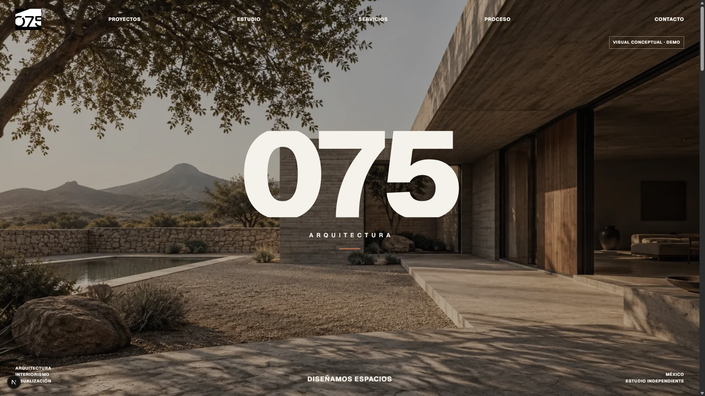
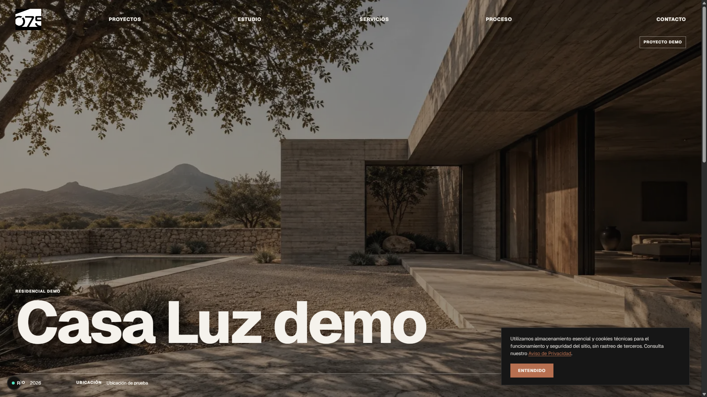
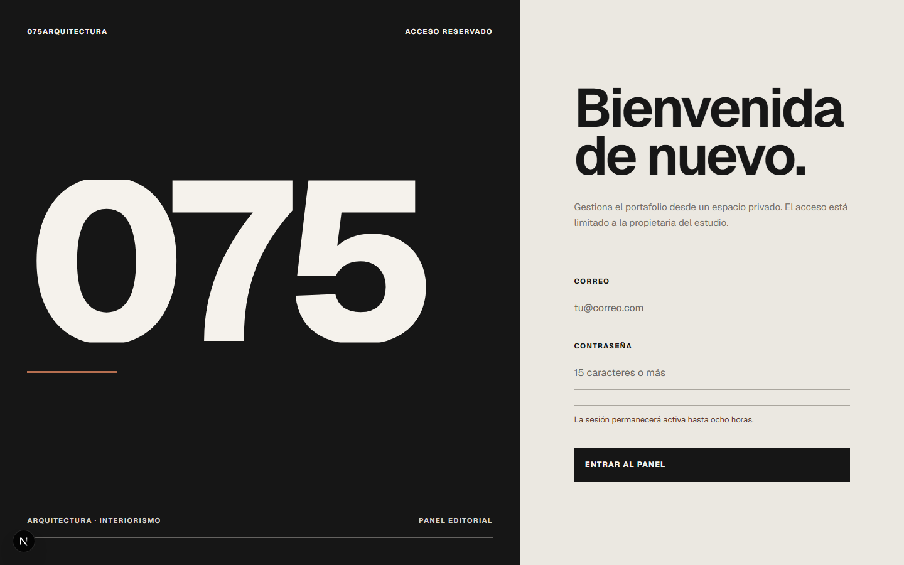

# 075arquitectura

[](https://nextjs.org/)
[](https://www.typescriptlang.org/)
[](https://react.dev/)
[](https://www.postgresql.org/)
[](https://www.docker.com/)
[](https://sharp.pixelplumbing.com/)
[](https://www.prisma.io/)

A self-hosted, monolithic Next.js application delivering a high-end architectural public portfolio and an integrated private editorial CMS for **075arquitectura**. Engineered as an all-in-one full-stack platform, it eliminates separate backend services and third-party media vendors (no AWS S3, Cloudinary, or Vercel lock-in) by leveraging PostgreSQL for relational metadata and persistent local disk storage paired with native Sharp image processing.

---

## Preview

### Public Architectural Showcase

<div align="center">
  
</div>

<p align="center">
  <em>Public architectural landing showcasing the custom editorial layout and responsive portfolio showcase.</em>
</p>

### Project Detail & Interactive Consent

<div align="center">
  
</div>

<p align="center">
  <em>Architectural project detail layout with integrated specs, responsive gallery, and privacy consent banner.</em>
</p>

### Private Editorial CMS Control Panel

<div align="center">
  
</div>

<p align="center">
  <em>Hardened administrative back-office access (<code>/admin/acceso</code>) with Argon2id session authentication.</em>
</p>

---

## Key Engineering Highlights

### Native Sequential Image Optimization Pipeline (Sharp)

Rather than delegating media transformation to external SaaS APIs, image processing is executed entirely within the application runtime using **Sharp** (libvips):

- **Sequential Processing:** Browsers may stream up to 3 concurrent uploads, but the server processes images through a strict single-concurrency queue (`lib/media/processor.ts`) to avoid memory spikes and protect CPU availability.
- **Strict Format & Payload Constraints:** Accepts JPEG, PNG, and WebP up to 20 MB. Preserves transparency, auto-rotates via EXIF orientation, and completely strips sensitive GPS and EXIF metadata before generating public assets.
- **Adaptive Compression:** Photographic assets are compressed to WebP at quality 88; architectural floor plans and PNG diagrams use WebP near-lossless compression to guarantee crisp vector and linework fidelity.
- **Multi-Screen Breakpoints:** For each uploaded master image, the pipeline generates up to five responsive WebP variants without upscaling:

| Output Asset   | Max Width | Target Device & Viewport         |
| :------------- | --------: | :------------------------------- |
| `mobile.webp`  |    480 px | Mobile smartphones               |
| `tablet.webp`  |    768 px | Tablets and portrait displays    |
| `laptop.webp`  |   1280 px | Standard laptops                 |
| `desktop.webp` |   1920 px | High-definition desktops         |
| `wide.webp`    |   2560 px | Ultra-wide displays & lightboxes |

_Images smaller than 480 px yield exclusively a `mobile.webp` asset at native resolution._

- **Opaque Storage & Private Originals:** Master source images are archived privately on disk (`uploads/projects/`, `uploads/site/hero/`) and are never exposed via public URLs. Database records store only opaque, relative keys. Public delivery occurs strictly through the authorized stream handler `/media/[mediaKey]/[variant]`.
- **Atomic Operations & Cleanup:** Incomplete, canceled, or orphaned uploads older than 24 hours are reconciled and purged via automated maintenance routines.

---

## Security & Production Design

Engineered specifically for hardened, self-hosted deployment on **Ubuntu Linux**:

- **Authentication & Cryptographic Security:**
  - Dedicated single-administrator model without public user registration or automated password recovery.
  - Passwords are encrypted using **Argon2id** with calibrated memory and parallelism costs.
  - Mitigates timing attacks using randomized dummy hashes (`dummyPasswordHash`) when email addresses do not match.
  - Implements brute-force throttling (`LoginThrottleScope`) blocking abusive client IPs and repeated targeted account attempts.
  - Admin sessions are encrypted, capped at eight hours, and cryptographically revalidated against PostgreSQL on sensitive routes.
- **Container Hardening:**
  - Built with `output: "standalone"` via Next.js for minimal image footprint.
  - The production container runs under a non-root unprivileged service account (`USER nextjs`, UID 1001).
  - Port `3000` is bound strictly to loopback (`127.0.0.1:3000`) so the system is only accessible through the reverse proxy.
- **Reverse Proxy Requirements (Nginx / Caddy):**
  - Proxy buffers must allow upload payloads greater than 20 MB with sufficient execution timeouts.
  - Must forward real client identities via `X-Real-IP` and `X-Forwarded-For` for rate limiting.
- **Persistent Volume Architecture:**
  - Docker mounts the host storage volume persistently:
    ```text
    /srv/075arquitectura/uploads:/data/uploads
    ```
  - Backups atomically archive both PostgreSQL dumps and `/srv/075arquitectura/uploads` in synchronized schedules.

---

## Local Development & Setup

### Prerequisites

- **Node.js:** `>=24.11.0` (matching `.nvmrc`)
- **npm:** `>=11.6.1`
- **Docker & Docker Compose** (for local PostgreSQL engines)

> [!IMPORTANT]
> Install dependencies on the exact host operating system where the runtime executes (`npm ci`). Never copy `node_modules` between Windows and Linux.

### 1. Environment Configuration

Copy the example environment template and configure your secrets:

```bash
# On Linux/macOS
cp .env.example .env

# On Windows PowerShell
Copy-Item -LiteralPath '.env.example' -Destination '.env'
```

Required environment variables in `.env`:

- `DATABASE_URL`: Primary development PostgreSQL connection string (`127.0.0.1:5432`).
- `TEST_DATABASE_URL`: Isolated test database connection string (`127.0.0.1:5433`).
- `AUTH_SECRET`: Random 32+ character secret for NextAuth session encryption.
- `ADMIN_EMAIL`: Email for the primary administrative owner.
- `ADMIN_PASSWORD`: Strong password (between 15 and 128 characters).
- `UPLOADS_ROOT`: Local directory for asset storage (`./uploads`).

### 2. Infrastructure & Database Initialization

```bash
# 1. Start development (port 5432) and test (port 5433) PostgreSQL containers
docker compose up -d postgres postgres-test

# 2. Deploy versioned Prisma migrations
npm run db:migrate:deploy

# 3. Create the administrative user from .env credentials
npm run db:bootstrap-admin

# 4. Seed initial demonstration categories and projects (idempotent)
npm run db:seed

# 5. Start Next.js in development mode
npm run dev
```

The web application is accessible at `http://localhost:3000` and the private management panel at `http://localhost:3000/admin`.

### Cross-Platform TypeScript Execution

Windows shells occasionally struggle with standard `tsx` user identity resolution. This repository includes an internal cross-platform runner ([scripts/run-tsx.mjs](file:///e:/Escritorio/Proyecto/075Arquitectura/075arquitectura-web/scripts/run-tsx.mjs)) guaranteeing consistent execution across Windows and Linux environments without prior compilation steps.

---

## Database Management & CLI Tooling

- `npm run db:generate`: Generates the typed Prisma client in `generated/prisma`.
- `npm run db:migrate`: Creates and applies new database migrations during development.
- `npm run db:migrate:deploy`: Applies pending versioned migrations in production or staging.
- `npm run db:status`: Inspects migration history against PostgreSQL metadata.
- `npm run db:bootstrap-admin`: Safely registers the administrator user using `ADMIN_EMAIL` and `ADMIN_PASSWORD` (idempotent, prevents overwriting existing records).
- `npm run db:seed`: Seeds initial architectural catalogue data without touching administrator records.
- `npm run db:test:reset`: Drops, recreates, migrates, and seeds exclusively the isolated test database on port `5433`.

---

## Quality & Verification

Every pull request and deployment must pass the consolidated verification gate:

```bash
npm run check
```

The master gate runs the following checks in sequence:

1. **Prettier Check:** `npm run format:check` — Enforces consistent editorial code style.
2. **ESLint:** `npm run lint` — Validates TypeScript and Next.js App Router rules.
3. **Type Checking:** `npm run typecheck` (`tsc --noEmit`) — Validates strict static types.
4. **Integration Tests:** `npm run test:integration` — Resets the isolated test database on port `5433` and executes 100+ Vitest integration tests covering authentication, Sharp image transforms, rate limiting, and public projections.
5. **Production Compilation:** `npm run build` — Validates full static generation and Turbopack standalone output.

Individual test runners:

```bash
# Run Vitest in interactive watch mode
npm run test

# Run test suite once
npm run test:run
```
